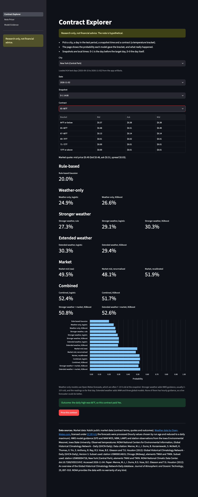
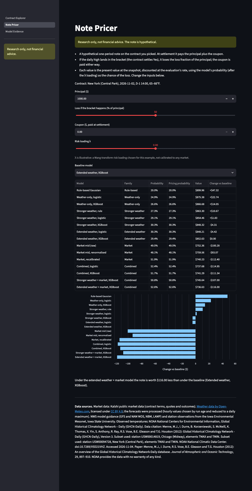
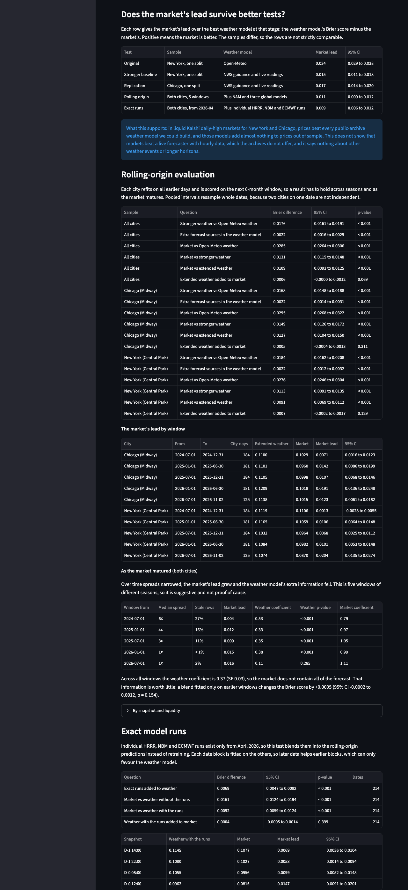
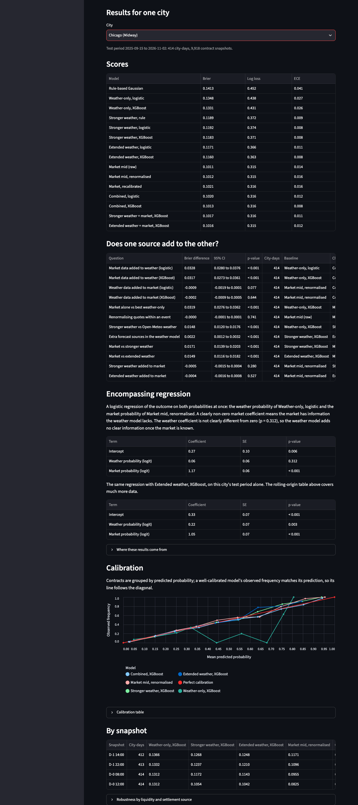
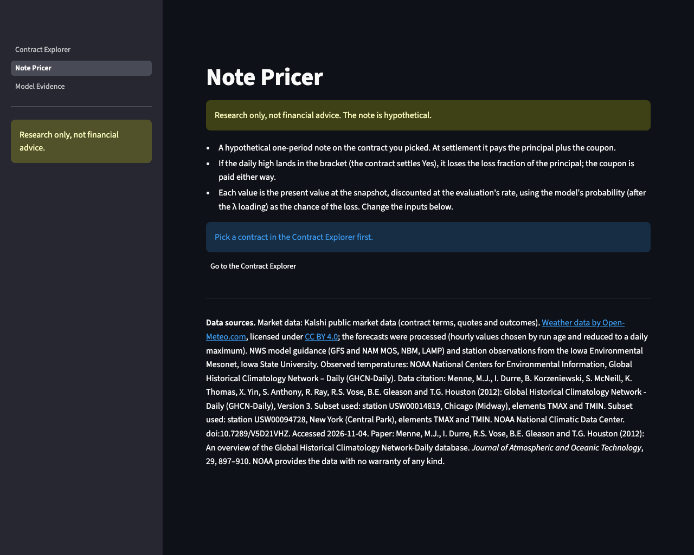
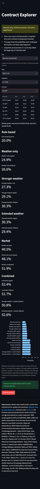

# Weather prediction markets as alternative data

This is a minimum viable research prototype. It tests one question:

> Do market-implied probabilities from weather prediction markets improve the estimation
> and pricing of weather-related risk beyond what meteorological data alone achieves?

The research case is the Kalshi markets on daily high temperature. New York (Central Park)
is the first city. Chicago (Midway) is the extension. Each contract pays if the official
daily high is in a bracket, for example "70–71°F" or "77° or above".

The prototype asks two things:

1. Do the market prices add information to an archived numerical weather prediction (NWP)
   forecast?
2. How much does the difference change the value of a hypothetical weather-linked note?

## What this is

A research pipeline and a small Streamlit app for a risk analyst who prices a
hypothetical temperature-linked note. The app answers one question: **how much does the
probability source (a weather model, the market, or both) change the value of the
note?** It is research only, not financial advice; the note is hypothetical and the
risk loading λ is illustrative.

## Features

Research pipeline (`src/weather_pricing/`):

- Collectors for Kalshi (contracts, outcomes, hourly candles), Open-Meteo (archived NWP
  runs by run age) and NOAA GHCN-Daily (observed highs), with a cached, throttled HTTP
  client.
- A point-in-time dataset: one row per contract and snapshot, built only from
  information published before the snapshot, with a data-quality report.
- Eight models: a rule-based Gaussian, weather-only (logistic, XGBoost), market-only
  (raw mid, renormalised mid, recalibrated logistic) and combined (logistic, XGBoost).
- Evaluation: Brier score, log loss, ECE, reliability tables, an event-clustered
  bootstrap, a forecast-encompassing regression and robustness cuts.
- A one-period note valuation with a Wang-transform risk loading.
- `app-artifacts`: saves models, out-of-sample predictions, per-city results, the tables
  across cities and a manifest (commit, source-tree hash, package versions, data range,
  row counts, NOAA access date) to `app_artifacts/`.

App (`app/`, gets all its data through `src/weather_pricing/inference.py`):

- **Contract Explorer**: pick New York or Chicago, a test-period day, snapshot and
  contract. Compare the probability of every model by family, including the stronger
  and extended weather models, and see the market quote and the outcome.
- **Note Pricer**: value the note on that contract under every model. Change the
  principal, loss fraction, coupon and λ, and compare each model with a chosen baseline,
  by default the extended weather model.
- **Model Evidence**: how the market's lead changes across better tests, the
  rolling-origin and exact-run tables, then per-city scores, bootstrap confidence
  intervals, encompassing regressions, calibration, results by snapshot, robustness,
  limitations and data sources.
- Every page: short instructions, loading and error messages without stack traces, a
  layout that works on phones, and the research-only notice.

## Installation

Python 3.12 (the version the app artifacts were built with). From the repo root:

```bash
python3.12 -m venv .venv
source .venv/bin/activate
pip install -r requirements-dev.txt
```

If `python3.12` is not on the PATH, use the full path to a Python 3.12, for example
Homebrew's `/opt/homebrew/opt/python@3.12/bin/python3.12 -m venv .venv`. All later
commands assume the virtual environment is active.

`requirements.txt` pins the exact package versions of the artifacts and installs the
package itself (`.`), so run it from the repo root. For development, an editable install
works too: `pip install -e '.[dev,app]'`; it does not pin the versions the artifacts
were built with.

## Environment and API keys

No API keys are needed: Kalshi, Open-Meteo and NOAA are used through public, token-free
endpoints. The repo follows the `.env` pattern anyway: `.env.example` lists the
settings (none today); copy it to `.env` for local values. `.env` and `.env.*` are
ignored by git (only `.env.example` is tracked); never commit a filled-in `.env`.

## Quick start

```bash
pip install -e '.[dev,app]'
```

```bash
python -m weather_pricing.cli build --cities NY --start 2023-01-01
```

```bash
python -m weather_pricing.cli evaluate
```

```bash
pytest -q
```

`build` downloads all data from read-only public endpoints. It needs no API keys. It
caches each raw response under `data/raw/`. A rebuild still needs the network: the
Kalshi listings and historical cutoff, Open-Meteo chunks that end in the last 8 days and
NOAA's current year are always fetched again; candles and older weather data come from
the cache. `evaluate` and the app run offline. `build` writes
`data/processed/snapshots.parquet` and `results/data_quality.json`.

`evaluate` writes `results/summary.md` and the CSV and JSON detail files.

## Usage guide

All commands run from the repo root with the virtual environment active
(`source .venv/bin/activate`).

**1. Build the data and the results.**

```bash
python -m weather_pricing.cli build --cities NY --start 2023-01-01
python -m weather_pricing.cli evaluate
```

The first `build` for New York takes about 35–45 minutes, mostly Kalshi candles at
about 5 requests per second; it ends by printing the data-quality report. `evaluate`
takes seconds and prints the results summary (see Results).

**2. Build the app artifacts.** This needs both cities' data and the rolling-origin and
exact-run results, so run the commands under "Strengthening the main finding" first.

```bash
python -m weather_pricing.cli app-artifacts --data snapshots snapshots_chi
```

This writes `app_artifacts/` (about 3 MB): `predictions.parquet`, `evidence/<city>/` with
each city's results, `finding/` with the tables across cities and `manifest.json`. Each
city has its own fits on its own chronological split. The app reads only this folder. The
fitted models go to `results/app/models.pkl`, which git ignores, because the app never
reads them and this command reproduces them. `evaluate --save-artifacts` still builds the
older single-run layout, which the app can also read, and it replaces these files.

**3. Run the app.**

```bash
streamlit run app/streamlit_app.py
```

Start it from the repo root, so Streamlit finds `.streamlit/config.toml`, and open the
local URL it prints.

**4. Worked example.** In the Contract Explorer, pick New York, 2026-11-02, snapshot
D-1 14:00 (34 hours before the day ends) and the bracket 65–66°F:

- The market quote is a mid price of \$0.49 (bid \$0.48, ask \$0.51) with a spread of
  \$0.03.
- The probabilities are 20.0 % (rule-based Gaussian), 26.6 % (weather-only, XGBoost),
  29.4 % (extended weather, XGBoost), 48.1 % (market mid, renormalised) and 52.6 %
  (extended weather + market, XGBoost).
- The outcome: the daily high was 66°F, so the contract paid Yes.

Press **Price this contract**. With the default note (principal \$1,000, loss 50 % of
the principal, coupon \$0, λ = 0) the present value is \$852.63 under the extended
weather model, which is the default baseline, \$759.56 under the renormalised market mid
and \$736.63 under the extended weather + market model, which values the note \$116.00
lower than the baseline. With λ = 0.25 the three values are \$807.00, \$709.98 and
\$687.80. Model Evidence then shows how these models score across cities and windows.

**Screenshots** (in `docs/screenshots/`). To retake all six, start the app on port 8599 and
run `python scripts/take_screenshots.py` (it needs `pip install playwright` and Google
Chrome).

- Contract Explorer with the worked-example contract: selectors, quote, probabilities by
  family, outcome.

  

- Note Pricer after "Price this contract": principal 1,000, loss 50 %, coupon 0, λ 0,
  baseline extended weather XGBoost.

  

- Model Evidence: the market's lead across better tests, the conclusion, and the
  rolling-origin and exact-run tables.

  

- Model Evidence for Chicago: scores, comparisons, encompassing regressions, calibration
  and results by snapshot.

  

- Note Pricer opened in a fresh session without a contract: the hint and the link back.

  

- Contract Explorer at phone width (about 390 px).

  

## Data

| Source | Endpoint | Use |
|---|---|---|
| Kalshi | `/markets`, `/historical/markets`, `.../candlesticks` (hourly) | Contract terms, outcomes, bid/ask/last, volume |
| Open-Meteo | previous-runs API, `temperature_2m_previous_day1..5` | Archived NWP forecasts at a known run age |
| NOAA NCEI | Access Data Service, GHCN-Daily `TMAX` | Independent check of outcomes, persistence feature |
| Iowa Environmental Mesonet | ASOS observations and archived GFS MOS, NBM and LAMP guidance | Stronger weather baseline |

### Results of the feasibility audit (plan Weeks 1–2)

- **The history is longer than we expected.** Kalshi has NYC daily-high markets from
  Aug 2021. The series name was `HIGHNY` until 24 Oct 2024, and `KXHIGHNY` after that
  date. For markets that settled before the exchange's historical cutoff, only the
  `/historical/*` endpoints return data. Asking for series `KXHIGHNY` also returns the
  older `HIGHNY-…` markets; asking for `HIGHNY` returns nothing (checked 2026-11-04).
- **The lead times are short.** A market opens at about 10:00 ET on the day before its
  target date. It stops trading at local midnight. Thus, the 7-day and 3-day horizons in
  the plan do not exist. The builder takes snapshots at D-1 14:00, D-1 22:00, D-0 08:00
  and D-0 12:00 local time. These are 34 to 12 hours before the target day ends.
- **The settlement source changed.** Contracts for target days up to 2026-08-13 cite the
  NWS Daily Climate Report; from 2026-08-14 they cite The Weather Company. The rule-text
  extractor records the source for each contract; `data_quality.json` counts the
  contracts per source, and the robustness results (and the app's Model Evidence page)
  show the scores per source.
- **The contract structure changed.** In 2021–22, each event was a ladder of thresholds
  (">45°", ">47°"). From late 2022, the contracts in each event cover all temperatures: a
  low tail, 2°F brackets and a high tail. Thus, the quotes in one event can be
  renormalised so that they sum to one.
- **Some old listings have no structured strikes.** The builder reads their bracket from
  the rule text. This is the "LLM-assisted extraction" step in the plan, done here with a
  validated regex extractor. The builder sets the flag `strikes_from_text` on these rows.
- **Kalshi limits the request rate.** Above approximately 5 requests per second, Kalshi
  returns HTTP 429. Thus, the first download of one city-year of candles takes
  approximately 10 minutes.

### Prevention of look-ahead bias

Each row is one contract at one snapshot time. All features on a row were public at that
time:

- **Quotes:** the builder uses the last hourly candle that *closed* before the snapshot.
- **Forecasts:** for each valid hour `t`, the builder selects `previous_dayN` with
  `N ≥ ceil((t − snapshot + 6h) / 24h)`. This is the newest of Open-Meteo's
  `previous_day1..5` runs that had been published before the snapshot, assuming a run is
  published 6 hours after it starts. No run younger than `previous_day1` (started about
  a day before the valid hour) is available, so the forecast used is often 7–23 h old at
  the snapshot and is the same at D-0 08:00 and D-0 12:00 (see Limitations). The daily
  maximum comes from these hourly values.
- **Persistence:** the builder uses the observed high of the last local day that ended
  before the snapshot.
- **Splits:** the split is chronological by target date. All contracts and snapshots of a
  city-day have one outcome. Thus, they are always in the same split, and the bootstrap
  resamples whole city-days.

## Models

| Name | Family | Inputs |
|---|---|---|
| `R_gaussian_rule` | Rule-based | Forecast plus a training-period bias, with N(0, σ) error by city and lead bucket, integrated over the bracket |
| `A_logit`, `A_xgb` | Weather-only (Model A) | Gaussian bracket probability, bracket z-scores, lead, forecast revision, persistence anomaly, season |
| `B_market_mid`, `B_market_norm` | Market-only (Model B) | Raw mid, and mid renormalised within the event |
| `B_logit` | Market-only, recalibrated | Logit mid, spread, volume, staleness |
| `C_logit`, `C_xgb` | Combined (Model C) | A + B features |

We compare A and C with the same learner: logistic against logistic, and XGBoost against
XGBoost. Thus, any gain comes from the market data, not from the model type.

XGBoost selects its number of trees on the last 20% of the training period. Then it fits
again on the full training set.

The MVP does not include deep learning (LSTM/TFT) or an LLM extractor (Model D). The plan
recommends a narrow first prototype.

## Evaluation

- Brier score, log loss, expected calibration error (ECE) and reliability tables.
- **Event-clustered bootstrap** of the Brier differences, with a 95% CI and a two-sided
  p-value.
- **Forecast-encompassing regression** with cluster-robust standard errors:
  `logit P(y) = a + b1·logit(p_weather) + b2·logit(p_market)`. If `b2` is significant, the
  market has information that the weather model does not have. This test examines the
  central hypothesis of the plan more directly than accuracy near settlement does.
- Robustness cuts by snapshot time, liquidity (spread or staleness) and city.

## Valuation

Each contract has a hypothetical one-period note. The principal is N = $1,000. The note
loses L = 50% of the principal if the bracket event occurs:

    V_t = D(t,T) · (C + N · (1 − q_t · L)),   q_t = Φ(Φ⁻¹(p_t) + λ)

When λ = 0, V_t is the discounted expected payoff. This is the formula in Section 6 of the
plan. When λ > 0, the formula applies a Wang-transform risk loading. The loading shows a
point from the plan: forecast probabilities are not risk-adjusted pricing probabilities.

The outputs are:

- the change in value when Model C replaces Model A
- the RMSE of the value against the realised payoff (for reference only: with λ = 0 it
  equals D·N·L·√Brier, a rescaled Brier score, so it is not separate evidence)
- the value for a range of λ values

The horizon is approximately one day, so the discount factor is almost 1. Thus, the value
differences are approximately N·L·Δp.

## Results

These results are from the reproduced run of 2026-11-04, with New York data only (see
"Reproduction" below for the differences from the first run). The command was
`python -m weather_pricing.cli evaluate` with default settings. `results/summary.md` has
the full tables.

**Sample.** The sample has 1,401 city-days and 8,403 contracts, in 33,473 snapshot rows
(2023-01-01 to 2026-11-02). 32,951 rows are used; the other 522 lack a complete day of
forecast hours. The data quality is good:

- The bracket logic gives the same result as Kalshi for 100% of contracts.
- NOAA TMAX gives the same outcome for 99.98% of contracts.
- Where Kalshi reports a settled temperature, NOAA TMAX equals it on 99.55% of the 1,331
  city-days that have both values, and is within 1°F on 99.92%.
- The rule text and the strikes agree for all contracts.
- 40 rows (0.1%) belong to an event whose brackets were not all quoted at that snapshot;
  they keep the raw mid instead of the renormalised one.
- In `data_quality.json`, `event_mid_sum_median` (1.07) is now computed over complete
  bracket sets only.

**Split.** The training set has 965 city-days (2023-01-01 to 2025-09-14), in 23,033 rows.
The test set has 414 city-days (2025-09-15 to 2026-11-02), in 9,918 rows.

| Model | Brier | Log loss | ECE |
|---|---|---|---|
| Rule-based Gaussian | 0.1437 | 0.462 | 0.054 |
| A: weather-only, logistic | 0.1345 | 0.434 | 0.015 |
| A: weather-only, XGBoost | 0.1278 | 0.412 | 0.018 |
| B: market mid, renormalised | **0.0941** | **0.293** | 0.015 |
| C: combined, logistic | 0.0954 | 0.296 | 0.022 |
| C: combined, XGBoost | 0.0950 | **0.293** | **0.013** |

1. **Market prices add much information to this weather baseline.** With XGBoost, the change
   from A to C decreases the Brier score by 0.033 (26%). The event-clustered 95% CI is
   0.028 to 0.037, and p < 0.001. The gain occurs at all snapshot times. At D-1 14:00,
   approximately 34 hours before the day ends, the market score is 0.109. The weather
   model score is 0.132.
2. **This weather baseline adds no information to market prices.** For C_xgb against B, the
   Brier difference is −0.0009 (CI −0.0024 to 0.0005, p = 0.20): C_xgb is not better than
   the market. C_logit is *worse* than the market (−0.0013, CI −0.0021 to −0.0005).
3. **The market prices contain the information in this forecast.** In the encompassing
   regression, the market coefficient is 1.22 (SE 0.06). The weather coefficient is −0.14
   (p = 0.12). A market coefficient above 1 shows that the quotes are slightly too close
   to 50%. But the recalibrated `B_logit` model did not get an out-of-sample gain from
   this.
4. **The result is robust.** It is true for all liquidity buckets and for both settlement
   sources. The gain is larger with The Weather Company (0.050) than with NWS (0.029). But
   The Weather Company settles only 81 of the 414 test city-days (2026-08-14 to
   2026-11-02).
5. **Valuation.** When the note uses Model C instead of Model A, its value changes by \$63
   on average. The 90th percentile is \$143 per \$1,000. The RMSE against the realised
   payoff falls from \$179 to \$154, but this is the Brier result in dollars
   (D·N·L·√Brier), not separate evidence. A Wang loading of λ = 0.25 decreases the mean
   value by approximately \$23. This does not show that the risk premium matters as much
   as the forecast source: λ = 0.25 is illustrative, not calibrated, and the \$23 is a
   shift of the mean value while the \$63 is the average size of contract-by-contract
   changes, so the two numbers measure different things.

**Interpretation.** The weather baseline is one deterministic NWP run (Open-Meteo best
match) from a public archive, with simple statistical post-processing. Traders very
probably use ensembles, MOS/NBM guidance and live station observations. At the D-0 08:00
and D-0 12:00 snapshots, the morning observations are already available. Thus, part of the
market advantage comes from nowcasting.

Thus, the data supports this claim: *Kalshi prices contain all the information in this
public deterministic NWP forecast (Open-Meteo best match) for this type of event.* These results are about this
weather baseline only; they are not evidence that prediction markets are better than
meteorology in general. "Stronger weather baseline" below repeats the test with NWS
guidance and same-day observations.

### Reproduction (2026-11-04)

The data was downloaded again and the evaluation rerun with default settings
(`build --cities NY --start 2023-01-01`, then `evaluate`). All conclusions of the first
run hold. The differences:

- **More data.** The data now ends on 2026-11-02, so there are 3 more city-days
  (1,401 instead of 1,398), and the train/test cut moved slightly (965/414 instead of
  963/413 city-days).
- **Stricter forecast rule.** A row now needs every forecast hour of the local day,
  including 23- and 25-hour days at the DST changes (before: at least 20 hours).
- **Bracket check.** Quotes are renormalised only when every bracket of the event is
  quoted at that snapshot. This affects 40 rows.
- **Scores** move by at most 0.0007 (Brier) and 0.005 (ECE).
- **Weather added to the market** (finding 2): the CI is wider than in the first run,
  and C_xgb is now slightly, not significantly, worse than the market. C_logit is
  significantly worse.
- **Renormalising quotes** makes no difference: the raw mid (`B_market_mid`, Brier
  0.0940) and the renormalised mid score the same (p = 0.56).
- The separate effect of the two rule changes was not measured: that would need a build
  with the old code.

The artifacts were then rebuilt with the same code and settings, using NOAA data
accessed on 2026-11-04. NOAA had published some recent daily highs by then, which fills
the persistence feature on 24 of the 9,918 test rows. Only the weather-only and combined
predictions on those rows change. No result reported above changes at the precision
shown, but the worked example is one of those rows.

## Stronger weather baseline

The results above leave one question open: how much of the market's lead comes from the
weak Open-Meteo baseline? This experiment gives the weather model what a forecaster could
actually see at each snapshot, on the same 9,918 test rows and the same split. Models A, B
and C are unchanged.

```bash
python -m weather_pricing.cli weather-baseline
```

The first run downloads the Iowa Environmental Mesonet archives (about 20 minutes at one
request every 6 seconds). Results go to `results/weather_baseline/`. The app's artifacts
are not touched.

**What the new model (W) sees.** Each value was public at the snapshot:

- GFS MOS and NBM forecasts of the daily high, plus NBM's own uncertainty estimate.
- LAMP hourly temperatures for the rest of the day.
- The Central Park readings so far today, which also set a floor: the final high cannot
  end below what the thermometer already read.

`W_rule` turns these into a predictive distribution for the daily high. `W_logit` and
`W_xgb` recalibrate it, and `CW_*` add the market features.

| Model | Brier | Log loss | ECE |
|---|---|---|---|
| A: Open-Meteo weather, XGBoost | 0.1278 | 0.412 | 0.018 |
| W: stronger weather, rule | 0.1124 | 0.352 | 0.018 |
| W: stronger weather, logistic | 0.1114 | 0.348 | 0.016 |
| W: stronger weather, XGBoost | 0.1088 | 0.340 | 0.011 |
| B: market mid, renormalised | **0.0941** | 0.293 | 0.015 |
| CW: stronger weather + market, XGBoost | 0.0943 | **0.292** | 0.010 |
| Cross-fitted blend of W_xgb and B | 0.0943 | 0.292 | **0.005** |

1. **The old baseline did overstate the market's lead.** W beats A by 0.019 Brier (95% CI
   0.015 to 0.023). The market's lead over the best weather model falls from 0.034 to
   0.015, a drop of about 56%.
2. **The market still clearly wins.** Its lead over W_xgb is 0.015 (CI 0.011 to 0.018),
   or 14% of W_xgb's Brier score.
3. **The lead no longer grows through the day.** Against A it rose from 0.022 at D-1 14:00
   to 0.049 at D-0 12:00. Against W it stays between 0.013 and 0.017, so the growth was
   mostly the old baseline's missing same-day information. The lead of 0.013 at D-1 14:00,
   when nobody has same-day readings, is the cleanest evidence of a market edge.

| Snapshot | A_xgb | W_xgb | Market | Market lead over W (95% CI) |
|---|---|---|---|---|
| D-1 14:00 | 0.1315 | 0.1219 | 0.1094 | 0.013 (0.009 to 0.016) |
| D-1 22:00 | 0.1297 | 0.1154 | 0.1023 | 0.013 (0.009 to 0.017) |
| D-0 08:00 | 0.1250 | 0.1055 | 0.0883 | 0.017 (0.013 to 0.022) |
| D-0 12:00 | 0.1250 | 0.0924 | 0.0764 | 0.016 (0.010 to 0.022) |

4. **Stronger weather still does not improve on the market out of sample.** CW_xgb against
   B is −0.0002 (CI −0.0015 to 0.0010). The logistic CW_logit is −0.0011 (CI −0.0023 to
   0.0000).
5. **The claim that prices contain all the forecast's information no longer holds strictly**
   (the rolling-origin evaluation below settles this more firmly).
   The encompassing regression now gives W_xgb a coefficient of 0.19 (SE 0.07, p = 0.005),
   and 0.37 (p = 0.001) at D-0 12:00. The old baseline's logistic model had −0.14 (p = 0.12),
   and its like-for-like match W_logit has 0.12 (p = 0.10) overall and 0.29 (p = 0.006) at
   D-0 12:00. The regression is fitted on the test rows, so the blend above checks it out of sample,
   fitting each of 5 date blocks on the other 4. The blend does not beat the market overall
   (−0.0002, CI −0.0012 to 0.0008) or at D-0 12:00 (+0.0007, CI −0.0008 to 0.0022). It is
   the best calibrated model, though. So the signal is real enough to detect but too small
   to lower the score reliably. These regressions are 10 tests, so read single p-values
   with care.
6. **Valuation.** The note's mean absolute value gap to the market falls from \$60 with A
   to \$39 with W. The choice of weather model still moves the note's value by a lot on
   individual contracts.

**Sensitivity.** Doubling the assumed guidance release delays (`--lag-scale 2`) leaves the
conclusions unchanged: the market's lead is 0.014 (CI 0.011 to 0.017), and CW_xgb against
the market is +0.0002 (CI −0.0011 to 0.0015). W_xgb came out slightly better with the longer delays
(0.1081), which cannot be real information. It shows XGBoost refits move scores by
about 0.0007, so differences smaller than that mean nothing.

**Audit.** All four forecast sources cover every test row, and same-day readings cover
every D-0 row. The observed floor was above the settled temperature on 0.25% of the 2,754
checks, and only one contract row paid Yes below its floor. Mean absolute error of the
forecasts, in °F:

| Snapshot | Open-Meteo | GFS MOS | NBM | LAMP | W centre |
|---|---|---|---|---|---|
| D-1 14:00 | 3.27 | 2.29 | 2.19 | 1.95 | 2.04 |
| D-1 22:00 | 2.89 | 2.19 | 2.08 | 1.67 | 1.78 |
| D-0 08:00 | 2.71 | 2.10 | 2.07 | 1.67 | 1.69 |
| D-0 12:00 | 2.71 | 2.10 | 2.07 | 1.64 | 1.37 |

**What this does not settle.** The weather model is still behind a live trader:

- **Guidance age.** The archive keeps only four LAMP runs a day until 2026-10-28, so the
  median guidance is 2 to 10 hours old at a snapshot. The readings are about 4 minutes old.
  Hourly guidance, HRRR and full ensembles are not included here, so some of the remaining
  lead may still be a data gap. "Strengthening the main finding" tests what the archives
  allow.
- **Assumed release delays.** GFS MOS 5 h, NBM 2 h, LAMP 1 h and observations 5 minutes are
  assumptions, not archived publication times. The sensitivity run covers the guidance
  delays.
- **Strike placement.** Kalshi sets its brackets around its expected temperature, so even
  the weather-only models see a small market signal in the contract terms. This favours
  the weather models, not the market.
- **Settlement source.** W's error model is mostly trained on NWS settlement. On the 81
  test days settled by The Weather Company the market's lead is larger (0.032 against
  about 0.01 under NWS), but that is a small sample.
- **Not a trading result.** These are mid prices with no spread or fees. One city, one split.

## Strengthening the main finding

Three further tests ask whether the finding depends on one city, one split or a weather
gap. All three keep the market as it was and try to make the case against it stronger.

```bash
python -m weather_pricing.cli build --cities CHI --start 2023-01-01 --end 2026-11-02 --name snapshots_chi
python -m weather_pricing.cli weather-baseline --data snapshots_chi
python -m weather_pricing.cli rolling --data snapshots snapshots_chi
python -m weather_pricing.cli exact-runs
```

Chicago's first download takes about 35 minutes for Kalshi and 20 for the weather archives.
The exact runs take about an hour. The main dataset and the app artifacts are not touched.

**Summary.** The market's lead over the best weather model at each stage:

| Test | Sample | Weather model | Market lead (95% CI) |
|---|---|---|---|
| Original | NY, one split | A (Open-Meteo) | 0.034 (0.029 to 0.038) |
| Stronger baseline | NY, one split | W (NWS guidance, readings) | 0.015 (0.011 to 0.018) |
| Replication | Chicago, one split | W | 0.017 (0.014 to 0.020) |
| Rolling origin | Both cities, 2024-07 on | X (W + more sources) | 0.011 (0.009 to 0.012) |
| Exact runs | Both cities, 2026-04 on | X + HRRR, NBM, ECMWF runs | 0.009 (0.006 to 0.012) |

Each better test shrinks the lead, and none closes it. The rows are not strictly
comparable, since the samples differ. On the exact-run sample itself, the runs cut the lead
from 0.016 to 0.009.

### Chicago replication

Chicago settles at a different station and had no part in designing the models. Its data
is as clean as New York's: the bracket logic reproduces all 8,411 results, and NOAA gives
the same outcome on every contract. On the same kind of split (test period 2025-09-15 to
2026-11-02):

| Model | Brier | Log loss | ECE |
|---|---|---|---|
| A: Open-Meteo weather, XGBoost | 0.1331 | 0.431 | 0.026 |
| W: stronger weather, XGBoost | 0.1183 | 0.371 | 0.008 |
| B: market mid, renormalised | **0.1012** | **0.315** | 0.016 |
| CW: stronger weather + market, XGBoost | 0.1017 | 0.316 | 0.011 |

The market's lead over W is 0.017 (CI 0.014 to 0.020), and adding W to the market gives
−0.0005 (CI −0.0015 to 0.0005). Both conclusions from New York hold.

### Rolling-origin evaluation

Each city gets 18 months of first training, then 6-month test windows from 2024-07-01,
refitting on all earlier days each time. That is 5 windows and 855 out-of-sample city-days
per city. Pooled intervals resample whole dates, because two cities on one date are not
independent. X is W plus NAM MOS and three more global models (ECMWF, ICON and GEM) from
March 2024, which also gives a multi-model spread.

| Comparison (Brier difference) | New York | Chicago | Both |
|---|---|---|---|
| Stronger weather (X) vs Open-Meteo (A) | 0.018 | 0.017 | 0.018 (0.016 to 0.019) |
| Extra sources (X vs W) | 0.0022 | 0.0022 | 0.0022 (0.0016 to 0.0029) |
| Market vs X | 0.0091 | 0.0127 | 0.0109 (0.0093 to 0.0125) |
| X added to market | +0.0007 | +0.0005 | +0.0006 (−0.0001 to 0.0012) |

1. **The lead holds across time and cities.** Its interval excludes zero in 9 of the 10
   city-windows. The exception is New York's first window (0.0013, CI −0.0028 to 0.0055).
2. **The lead is not uniform across the day.** It is 0.006 to 0.007 at D-1 14:00 and 0.014
   to 0.021 at D-0 12:00. Before anyone has same-day readings the edge is between a quarter
   and a half of that size. The weather model's guidance is hours old by noon, so the D-0 figures are the less
   trustworthy of the two.
3. **This corrects an earlier claim.** On one split the weather forecast looked worthless
   next to the market. Across all windows its coefficient is 0.37 (SE 0.03, p < 0.001)
   beside a market coefficient of 0.97, so the market does not contain all of it.
4. **That information is still worth very little.** X adds +0.0006 to the market, and a
   blend using only earlier windows adds +0.0005 (CI −0.0002 to 0.0012, p = 0.15). Neither is
   significant. A real signal and a negligible gain can both be true.
5. **The market looks stronger as it matures.** All five windows, both cities:

| Window from | Median spread | Stale rows | Market lead | Weather coefficient | Market coefficient |
|---|---|---|---|---|---|
| 2024-07 | 6c | 27% | 0.004 | 0.53 | 0.79 |
| 2025-01 | 4c | 16% | 0.012 | 0.33 | 0.97 |
| 2025-07 | 3c | 11% | 0.009 | 0.35 | 1.05 |
| 2026-01 | 1c | 0.2% | 0.015 | 0.38 | 0.99 |
| 2026-07 | 1c | 2% | 0.016 | 0.11 (p = 0.29) | 1.11 |

   Weather helps where the market is thin: it adds 0.0022 (CI 0.0011 to 0.0034) on stale
   rows and 0.0002 (CI −0.0004 to 0.0008) on rows with a spread of 2c or less. This is five
   windows of different seasons with a shorter final one, and weather models improved too,
   so it is suggestive and not proof of cause.

### Exact-run test

Open-Meteo keeps individual runs only from 2026-04-02, so this test covers 428 city-days
and cannot retrain the models. It takes the rolling-origin predictions, which never saw
these runs, and blends in a probability built from them. Each of 5 date blocks is fitted on
the other 4, so later data helps earlier blocks, which can only favour the weather model.

| Comparison, both cities | Brier difference (95% CI) |
|---|---|
| Runs added to weather | 0.0069 (0.0047 to 0.0092) |
| Market vs weather, without the runs | 0.0161 (0.0124 to 0.0194) |
| Market vs weather, with the runs | 0.0092 (0.0059 to 0.0124) |
| Weather with the runs added to market | +0.0004 (−0.0005 to 0.0014) |

The runs are clearly worth having: they remove about 43% of the lead on this sample. The
lead that remains is 0.005 to 0.007 on the day before and 0.010 to 0.015 on the day itself.

**What the archives could not provide.** Item by item:

- **Hourly guidance:** not archived. Individual HRRR and NBM runs are 3-hourly at best, and
  LAMP has four runs a day until 2026-10-28. Median run ages here are 3 to 7 hours for HRRR
  and NBM, and 9 to 11 for ECMWF.
- **Full ensembles:** Open-Meteo's ensemble API reaches back only about 90 days. The
  multi-model spread and NBM's own spread stand in for them.
- **Release delays:** HRRR and NBM 2 h, ECMWF 7 h and NAM 5 h are assumptions, like the earlier
  ones.

So part of the remaining lead may still be a data gap, especially on the day itself. The
sturdiest evidence of a market edge is the 0.006 to 0.007 lead at D-1 14:00, where same-day
data matters least, and that figure is small.

**Defensible claim.** *In liquid Kalshi daily-high markets for New York and Chicago, prices
beat every public-archive weather model we could build, and those models add almost nothing
to prices out of sample.* The data does not show that markets beat a live forecaster with
hourly data, and it says nothing about other weather events or longer horizons.

## Limitations

- **Forecast age.** The builder cannot use a run younger than `previous_day1`, so at the
  snapshot the forecast is often 7–23 h old, and it is the same at D-0 08:00 and D-0 12:00.
  This likely overstates the market's advantage. A forecast source with intraday runs is
  future work.
- **Short horizons.** These markets have horizons of 34 hours or less. The results give no
  information about weather risk over many days or seasons, or about cat-bond horizons.
- **Approximate NWP availability.** The model assumes that a run becomes available 6
  hours after initialisation. The Open-Meteo "best match" model also joins several NWP
  models, and it has some gaps (for example, early Jan 2024). If a row has a missing
  forecast hour, the experiment removes that row from all models.
- **Stale markets.** The quotes are hourly candle closes. In illiquid hours, the previous
  quote continues. The builder sets the flag `stale` on these rows, and the evaluation
  analyses them separately.
- **Hypothetical instrument.** The note is not a traded security. The experiment uses no
  real cat-bond prices. The λ values are examples, not calibrated values.
- **Settled temperatures before 2025.** Kalshi does not give most of these values. NOAA
  TMAX gives the missing values. The experiment uses these values only to fit the
  Gaussian error model. The labels always come from the Kalshi result.
- **Weak weather baseline.** Models A and C have no ensemble spread and no intraday
  observations (see Results). The W and X families add what the archives allow.
- **One test window in the main experiment.** Models A, B and C in the app and the main
  results use one chronological split. The rolling-origin evaluation covers 5 windows, for
  both cities.
- **Two cities.** New York and Chicago are not independent on shared weather days, and the
  other five configured cities have not been run.

## Known issues

- The app covers the test period only (2025-09-15 to 2026-11-02 for both cities in the
  current artifacts), because only those predictions are out-of-sample.
- A rebuild of the data needs the network (see Quick start); only `evaluate` and the app
  run offline.
- On Streamlit Community Cloud the Python version is chosen in the app's settings, not
  by this repo; it must be set to 3.12 by hand.

## Future enhancements

- A forecast source with intraday runs (removes the forecast-age limitation).
- Hourly guidance and full ensembles, if an archive appears.
- Event-level scores such as the ranked probability score.
- The other five configured cities, and live scoring of open Kalshi markets, which would
  also collect hourly forecasts going forward.
- Deep-learning models and an LLM-based rule extractor (Model D).

## Dependencies

Pinned in `requirements.txt` (the versions the app artifacts were built with):

| Package | Version | Used for |
|---|---|---|
| numpy | 2.5.4 | arrays and numerics |
| pandas | 3.1.0 | the dataset, results and app tables |
| pyarrow | 26.0.1 | parquet files (snapshots, predictions) |
| requests | 2.34.2 | the HTTP client of the collectors |
| scikit-learn | 1.9.1 | logistic models and scaling |
| scipy | 1.18.1 | normal distribution, logit, statistics |
| xgboost | 3.4.1 | the boosted-tree models |
| streamlit | 1.66.1 | the app (optional `app` extra in `pyproject.toml`) |
| altair | 6.3.0 | the app's charts (optional `app` extra) |

`requirements-dev.txt` adds pytest 9.2.0 for the test suite. Everything else is the
Python standard library.

## Data sources, attribution and licences

- **Kalshi**: contract terms, quotes and outcomes from Kalshi's public market-data API;
  Kalshi's terms of use apply to that data.
- **Open-Meteo**: <a href="https://open-meteo.com/">Weather data by Open-Meteo.com</a>,
  licensed under <a href="https://creativecommons.org/licenses/by/4.0/">CC BY 4.0</a>.
  The data was processed: hourly values were chosen by run age and reduced to a daily
  maximum.
- **NOAA NCEI GHCN-Daily**: Menne, M.J., I. Durre, B. Korzeniewski, S. McNeill,
  K. Thomas, X. Yin, S. Anthony, R. Ray, R.S. Vose, B.E. Gleason and T.G. Houston
  (2012): Global Historical Climatology Network - Daily (GHCN-Daily), Version 3. Subset
  used: stations USW00094728, New York (Central Park), and USW00014819, Chicago (Midway),
  elements TMAX and TMIN. NOAA
  National Climatic Data Center. doi:10.7289/V5D21VHZ. Accessed 2026-11-04 for the
  current artifacts (the app shows the date recorded in `app_artifacts/manifest.json`).
  Paper: Menne, M.J., I. Durre, R.S. Vose, B.E. Gleason and T.G. Houston (2012): An
  overview of the Global Historical Climatology Network-Daily database. *Journal of
  Atmospheric and Oceanic Technology*, 29, 897–910. NOAA provides the data with no
  warranty of any kind.
- **Iowa Environmental Mesonet** (Iowa State University): archived NWS model guidance and
  ASOS station observations for KNYC and KMDW, used in the stronger weather baseline.
- **Code**: the repository contains no licence file.

## Performance

Two caches keep the slow parts fast:

- **Cached, throttled data fetching** (`http.py`): every response is stored once under
  `data/raw/` (written atomically, so an interrupted download never leaves a broken
  file), requests to each source are spaced (Kalshi candles 0.2 s, Open-Meteo and NOAA
  0.5 s) and retried with back-off on HTTP 429/5xx, and candles download in 3 parallel
  threads. A rebuild only fetches what can change.
- **Cached artifact loading in the app** (`inference.py`): the predictions and the
  manifest are read once per server process (`functools.lru_cache`); the results files
  are read only when Model Evidence opens. The app never retrains or calls an API.

## Layout

```
src/weather_pricing/
  config.py          cities, snapshot times, availability assumptions
  http.py            cached, throttled GET
  collect/           kalshi.py, openmeteo.py, noaa.py, iem.py
  rules.py           rule-text extraction and validation, bracket logic
  dataset.py         point-in-time snapshot builder and data-quality report
  models.py          rule / A / B / C models
  evaluate.py        scores, calibration, clustered bootstrap, encompassing test
  valuation.py       one-period note, Wang transform
  experiment.py      split, fit, score, value, write results/
  artifacts.py       save models, predictions, results and the manifest for the app
  inference.py       the app's data layer: contracts, predictions, note prices, evidence
  guidance.py        point-in-time NWS guidance and same-day observation features
  guidance_plus.py   NAM, extra global models and individually archived model runs
  weather_plus.py    stronger weather models (W) and their market combination (CW)
  weather_experiment.py  market against the stronger weather models
  rolling.py         rolling-origin evaluation across cities
  exact_runs.py      test of individually archived model runs
  app_build.py       build app_artifacts/ for every city and model
  cli.py             build / evaluate (--save-artifacts) / weather-baseline / rolling / exact-runs / app-artifacts
app/                 Streamlit app: streamlit_app.py, the three pages, shared.py
app_artifacts/       what the app loads (built by app-artifacts)
docs/screenshots/    README screenshots
scripts/             take_screenshots.py, retakes the README screenshots
tests/               offline tests (synthetic data, no network)
requirements*.txt    pinned versions for the app and the tests
```
